# DIAGRAMA DE ENTIDAD-RELACIÓN - CHERRY APP

## Diagrama ERD (Mermaid)

```mermaid
erDiagram
    users ||--o{ orders : "crea"
    users ||--o{ addresses : "tiene"
    users ||--o{ carts : "tiene"
    users ||--o{ favorites : "tiene"
    users ||--o{ reviews : "escribe"
    users ||--o{ notifications : "recibe"
    users ||--o{ user_offers : "tiene"
    users }o--|| roles : "tiene"
    
    orders ||--o{ order_items : "contiene"
    orders }o--|| addresses : "envia_a"
    orders }o--|| users : "pertenece_a"
    
    carts ||--o{ cart_items : "contiene"
    carts }o--|| users : "pertenece_a"
    
    productos ||--o{ detalles : "tiene"
    productos }o--|| lineas : "pertenece_a"
    productos }o--o| generos : "tiene"
    productos }o--o| sectores : "tiene"
    productos }o--o| categories : "pertenece_a"
    
    productos ||--o{ order_items : "referenciado_en"
    productos ||--o{ cart_items : "referenciado_en"
    productos ||--o{ favorites : "favorito"
    productos ||--o{ reviews : "reseñado"
    
    catalogs ||--o{ catalog_products : "contiene"
    catalogs ||--o{ catalog_offers : "tiene"
    catalogs ||--o{ catalog_image_groups : "tiene"
    catalogs ||--o{ catalog_pdfs : "tiene"
    
    catalog_products }o--|| productos : "referencia"
    catalog_products }o--|| catalogs : "pertenece_a"
    
    catalog_image_groups ||--o{ catalog_images : "contiene"
    
    historials

    affiliate_seasons ||--o{ affiliate_season_boxes : "contiene"
    catalogs ||--o{ affiliate_seasons : "asociado"
    
    users {
        int id PK
        string email
        string password
        string first_name
        string last_name
        int role_id FK
        string seller_category
        decimal credit_balance
        decimal credit_limit
        datetime created_at
        datetime updated_at
    }
    
    roles {
        int id PK
        string name
        datetime created_at
        datetime updated_at
    }
    
    productos {
        string id PK
        int id_linea FK
        string descripcion
        string marca
        decimal precio1
        decimal precio2
        decimal precio3
        decimal precio4
        decimal precio5
        decimal precio6
        decimal precio7
        decimal precio8
        decimal precio9
        decimal precio10
        int inventario
        int stock_received_count
        date fecha_alta
        string opc_nuevo
        string opc_promo
        string catalogoId
        int sector_id FK
        int genero_id FK
        string imagen
        datetime created_at
        datetime updated_at
    }
    
    detalles {
        int id PK
        string producto_id FK
        string nombreColor
        string detalle
        int inventario_d
        string ean
        string sku
        datetime created_at
        datetime updated_at
    }
    
    orders {
        int id PK
        int user_id FK
        int address_id FK
        decimal total_amount
        decimal subtotal
        decimal discounted_total
        decimal shipping_amount
        decimal credit_used
        string status
        string payment_method
        string mercadopago_preference_id
        string mercadopago_payment_id
        boolean is_advance_order
        boolean is_prepared
        string tracking_number
        datetime delivered_at
        datetime created_at
        datetime updated_at
    }
    
    order_items {
        int id PK
        int order_id FK
        string product_id
        string color
        string size
        int quantity
        decimal price
        datetime created_at
        datetime updated_at
    }
    
    carts {
        int id PK
        int user_id FK
        datetime created_at
        datetime updated_at
    }
    
    cart_items {
        int id PK
        int cart_id FK
        string product_id
        string color
        string size
        int quantity
        datetime created_at
        datetime updated_at
    }
    
    addresses {
        int id PK
        int user_id FK
        string street_address
        string street_number_ext
        string street_number_int
        string city
        string municipality
        string colonia
        string state
        string postal_code
        string country
        decimal latitude
        decimal longitude
        boolean is_default
        datetime created_at
        datetime updated_at
    }
    
    catalogs {
        int id PK
        string name
        string code
        string description
        string image
        string pdf_path
        string pdf_name
        boolean is_active
        int display_order
        datetime created_at
        datetime updated_at
    }
    
    catalog_products {
        int id PK
        int catalog_id FK
        string product_id
        datetime created_at
        datetime updated_at
    }
    
    catalog_offers {
        int id PK
        int catalog_id FK
        decimal discount_percentage
        string discount_category
        datetime created_at
        datetime updated_at
    }
    
    user_offers {
        int id PK
        int user_id FK
        decimal discount_percentage
        string discount_category
        datetime created_at
        datetime updated_at
    }
    
    favorites {
        int id PK
        int user_id FK
        string product_id
        datetime created_at
        datetime updated_at
    }
    
    reviews {
        int id PK
        int user_id FK
        string product_id
        int rating
        text comment
        boolean is_approved
        datetime created_at
        datetime updated_at
    }
    
    notifications {
        int id PK
        int user_id FK
        string message
        string type
        datetime read_at
        datetime created_at
        datetime updated_at
    }
    
    catalog_image_groups {
        int id PK
        int catalog_id FK
        string name
        string pdf_path
        datetime created_at
        datetime updated_at
    }
    
    catalog_images {
        int id PK
        int catalog_image_group_id FK
        string image_path
        int display_order
        datetime created_at
        datetime updated_at
    }
    
    catalog_pdfs {
        int id PK
        int catalog_id FK
        string pdf_path
        string pdf_name
        datetime created_at
        datetime updated_at
    }
    
    categories {
        int id PK
        string name
        text description
        datetime created_at
        datetime updated_at
    }
    
    lineas {
        int id PK
        string name
        datetime created_at
        datetime updated_at
    }
    
    generos {
        int id PK
        string name
        datetime created_at
        datetime updated_at
    }
    
    sectores {
        int id PK
        string name
        datetime created_at
        datetime updated_at
    }
    
    historials {
        int id PK
        datetime ejecutado_at
        enum estado
        text mensaje
        datetime created_at
        datetime updated_at
    }

    affiliate_banners {
        int id PK
        string title
        text subtitle
        string button_text
        string button_url
        string image_path
        boolean is_active
        int display_order
        datetime created_at
        datetime updated_at
    }

    affiliate_seasons {
        int id PK
        string title
        string button_url
        int catalog_id FK
        string image_path
        boolean is_active
        int display_order
        datetime created_at
        datetime updated_at
    }

    affiliate_season_boxes {
        int id PK
        int affiliate_season_id FK
        string title
        text description
        string button_text
        string button_url
        string image_path
        boolean is_active
        int display_order
        datetime created_at
        datetime updated_at
    }

    affiliate_promo_banners {
        int id PK
        string image_path
        string button_url
        boolean is_active
        int display_order
        datetime created_at
        datetime updated_at
    }

    affiliate_bottom_banners {
        int id PK
        string image_path
        string button_url
        boolean is_active
        int display_order
        datetime created_at
        datetime updated_at
    }

    affiliate_faqs {
        int id PK
        string question
        text answer
        int display_order
        boolean is_active
        datetime created_at
        datetime updated_at
    }

    affiliate_trends {
        int id PK
        string title
        string button_url
        string image_path
        boolean is_active
        int display_order
        datetime created_at
        datetime updated_at
    }
```

---

## Descripción de Entidades

### users
**Rol**: Entidad central del sistema. Representa a los usuarios (vendedores/clientes) de la plataforma.
**Campos clave**: `email`, `password`, `seller_category` (oro/plata/bronce), `credit_balance`, `credit_limit`
**Relaciones**: 
- Tiene múltiples pedidos (`orders`)
- Tiene múltiples direcciones (`addresses`)
- Tiene un carrito (`carts`)
- Tiene productos favoritos (`favorites`)
- Escribe reseñas (`reviews`)
- Recibe notificaciones (`notifications`)
- Tiene ofertas personalizadas (`user_offers`)
- Pertenece a un rol (`roles`)

### productos
**Rol**: Entidad principal de productos. Almacena información general del producto.
**Campos clave**: `id` (string), `descripcion`, `marca`, `precio1-precio10`, `fecha_alta`, `opc_nuevo`, `inventario`, `stock_received_count`
**Relaciones**:
- Tiene múltiples variantes (`detalles` - colores/tallas)
- Pertenece a una línea (`lineas`)
- Puede pertenecer a un género (`generos`) y sector (`sectores`)
- Puede estar en múltiples catálogos (`catalog_products`)
- Referenciado en items de pedidos (`order_items`)
- Referenciado en items de carrito (`cart_items`)
- Puede ser favorito (`favorites`)
- Puede ser reseñado (`reviews`)

### detalles
**Rol**: Variantes de productos (combinaciones de color y talla).
**Campos clave**: `producto_id`, `nombreColor`, `detalle` (talla), `inventario_d` (stock por variante)
**Relaciones**:
- Pertenece a un producto (`productos`)
**Nota**: El stock total de un producto se calcula sumando `inventario_d` de todos sus detalles.

### orders
**Rol**: Pedidos realizados por usuarios.
**Campos clave**: `user_id`, `address_id`, `total_amount`, `subtotal`, `discounted_total`, `status`, `payment_method`, `mercadopago_preference_id`
**Relaciones**:
- Pertenece a un usuario (`users`)
- Se envía a una dirección (`addresses`)
- Contiene múltiples items (`order_items`)
**Estados**: pendiente, preparado, enviado, entregado

### order_items
**Rol**: Items individuales dentro de un pedido.
**Campos clave**: `order_id`, `product_id` (string, referencia a productos), `color`, `size`, `quantity`, `price`
**Relaciones**:
- Pertenece a un pedido (`orders`)
- Referencia un producto (`productos`)

### carts
**Rol**: Carrito de compras persistente en base de datos.
**Campos clave**: `user_id`
**Relaciones**:
- Pertenece a un usuario (`users`)
- Contiene múltiples items (`cart_items`)

### cart_items
**Rol**: Items individuales dentro del carrito.
**Campos clave**: `cart_id`, `product_id`, `color`, `size`, `quantity`
**Relaciones**:
- Pertenece a un carrito (`carts`)
- Referencia un producto (`productos`)

### addresses
**Rol**: Direcciones de envío de usuarios.
**Campos clave**: `user_id`, `street_address`, `city`, `state`, `postal_code`, `is_default`, `latitude`, `longitude`
**Relaciones**:
- Pertenece a un usuario (`users`)
- Usada en pedidos (`orders`)

### catalogs
**Rol**: Catálogos digitales de productos.
**Campos clave**: `name`, `code`, `image`, `pdf_path`, `is_active`, `display_order`
**Relaciones**:
- Contiene múltiples productos (`catalog_products`)
- Tiene ofertas (`catalog_offers`)
- Tiene grupos de imágenes (`catalog_image_groups`)
- Tiene PDFs (`catalog_pdfs`)

### catalog_products
**Rol**: Relación muchos-a-muchos entre catálogos y productos.
**Campos clave**: `catalog_id`, `product_id`
**Relaciones**:
- Pertenece a un catálogo (`catalogs`)
- Referencia un producto (`productos`)

### catalog_offers
**Rol**: Ofertas aplicables a productos de un catálogo específico.
**Campos clave**: `catalog_id`, `discount_percentage`, `discount_category`
**Relaciones**:
- Pertenece a un catálogo (`catalogs`)
**Tipos**: porcentaje, buy_x_get_y, order_discount, free_shipping

### user_offers
**Rol**: Ofertas personalizadas para usuarios específicos.
**Campos clave**: `user_id`, `discount_percentage`, `discount_category`
**Relaciones**:
- Pertenece a un usuario (`users`)

### favorites
**Rol**: Productos marcados como favoritos por usuarios.
**Campos clave**: `user_id`, `product_id`
**Relaciones**:
- Pertenece a un usuario (`users`)
- Referencia un producto (`productos`)

### reviews
**Rol**: Reseñas y calificaciones de productos.
**Campos clave**: `user_id`, `product_id`, `rating`, `comment`, `is_approved`
**Relaciones**:
- Pertenece a un usuario (`users`)
- Referencia un producto (`productos`)

### notifications
**Rol**: Notificaciones para usuarios.
**Campos clave**: `user_id`, `message`, `type`, `read_at`
**Relaciones**:
- Pertenece a un usuario (`users`)

### catalog_image_groups
**Rol**: Grupos de imágenes dentro de un catálogo.
**Campos clave**: `catalog_id`, `name`, `pdf_path`
**Relaciones**:
- Pertenece a un catálogo (`catalogs`)
- Contiene múltiples imágenes (`catalog_images`)

### catalog_images
**Rol**: Imágenes individuales dentro de un grupo de catálogo.
**Campos clave**: `catalog_image_group_id`, `image_path`, `display_order`
**Relaciones**:
- Pertenece a un grupo de imágenes (`catalog_image_groups`)

### catalog_pdfs
**Rol**: PDFs asociados a catálogos.
**Campos clave**: `catalog_id`, `pdf_path`, `pdf_name`
**Relaciones**:
- Pertenece a un catálogo (`catalogs`)

### categories
**Rol**: Categorías de productos.
**Campos clave**: `name`, `description`
**Relaciones**: Ninguna directa (se usa `id_linea` en productos)

### lineas
**Rol**: Líneas de productos.
**Campos clave**: `name`
**Relaciones**:
- Tiene múltiples productos (`productos`)

### generos
**Rol**: Géneros de productos.
**Campos clave**: `name`
**Relaciones**:
- Tiene múltiples productos (`productos`)

### sectores
**Rol**: Sectores de productos.
**Campos clave**: `name`
**Relaciones**:
- Tiene múltiples productos (`productos`)

### historials
**Rol**: Registro de ejecuciones del cronjob de sincronización de productos.
**Campos clave**: `ejecutado_at`, `estado` (exitoso/error), `mensaje`
**Relaciones**: Ninguna

### affiliate_banners
**Rol**: Banner superior editable de la página `/registro`.
**Campos clave**: `title`, `subtitle`, `button_text`, `button_url`, `image_path`, `is_active`, `display_order`

### affiliate_seasons
**Rol**: Sección de temporada visible en `/registro`.
**Campos clave**: `title`, `button_url`, `catalog_id`, `image_path`, `is_active`, `display_order`
**Relaciones**: Puede asociarse a un catálogo y contiene recuadros (`affiliate_season_boxes`).

### affiliate_season_boxes
**Rol**: Recuadros configurables dentro de una temporada.
**Campos clave**: `affiliate_season_id`, `title`, `description`, `button_text`, `button_url`, `image_path`, `is_active`, `display_order`
**Relaciones**: Pertenece a una temporada (`affiliate_seasons`).

### affiliate_trends
**Rol**: Tarjetas de tendencias de la página de afiliación.
**Campos clave**: `title`, `button_url`, `image_path`, `is_active`, `display_order`

### affiliate_promo_banners
**Rol**: Banners promocionales mostrados en el módulo FAQ.
**Campos clave**: `image_path`, `button_url`, `is_active`, `display_order`

### affiliate_bottom_banners
**Rol**: Banner inferior configurable del módulo FAQ.
**Campos clave**: `image_path`, `button_url`, `is_active`, `display_order`

### affiliate_faqs
**Rol**: Preguntas frecuentes dinámicas de `/registro`.
**Campos clave**: `question`, `answer`, `display_order`, `is_active`

---

## Notas Importantes

1. **Producto.id es string**: No es un integer auto-incremental, viene de la API externa.

2. **Stock**: El stock total de un producto se calcula sumando `inventario_d` de todos sus `detalles`. También existe `inventario` en `productos` y `stock_received_count`.

3. **Productos "Próximamente"**: 
   - `fecha_alta` es null, O
   - `stock_received_count = 0` AND `inventario <= 0`

4. **Productos "Nuevos"**:
   - `fecha_alta` dentro de 30 días, O
   - `opc_nuevo = 'S'`

5. **Usuarios "Oro"**: Pueden hacer encargos de productos "próximamente" (agregar al carrito aunque no haya stock).

6. **Carrito persistente**: Se guarda en BD, no solo en localStorage del navegador.

7. **Ofertas**: Se aplican tanto a nivel de catálogo (`catalog_offers`) como a nivel de usuario (`user_offers`).

8. **Referencias a productos**: En `order_items`, `cart_items`, `favorites`, y `reviews`, `product_id` es string (no FK directa).
